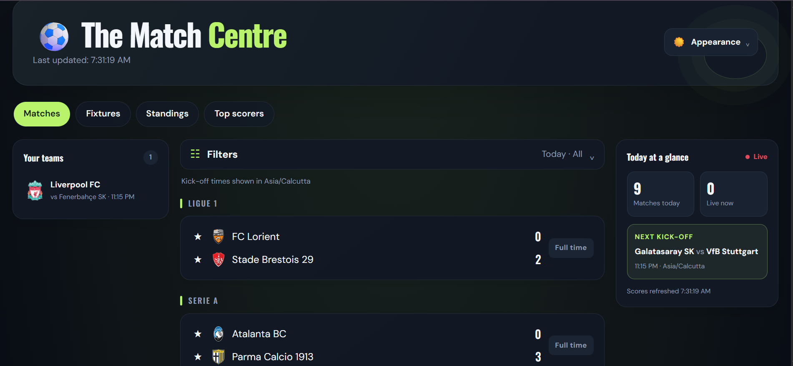

# ⚽ The Match Centre

A football scores site with live matches, fixtures, league tables and top scorers for 12 competitions. It keeps its own copy of the data in a PostgreSQL database, so it stays fast and inside the free API limits however many people open it.

**🔗 Live demo:** https://sports-trackers1-six.vercel.app



## Features

- **Matches:** today's, yesterday's and tomorrow's games, grouped by league, with live status badges.
- **Fixtures:** browse any league matchday by matchday.
- **Standings:** league tables, with group tables for tournaments such as the World Cup.
- **Top scorers:** goals, assists and penalties per league.
- **Your teams:** pin your favourite teams.
- **Filters:** search for a team, show live matches only, and filter by league or day.
- **Today at a glance:** matches today, matches live now, and the next kick-off.
- **Appearance:** switch theme and accent colour.
- Kick-off times are shown in the visitor's local time.

## Tech stack

| Part | Technology |
|---|---|
| Framework | Next.js (App Router) with React |
| Styling and animation | Tailwind CSS, Framer Motion |
| Database | PostgreSQL on Neon, via the `pg` library |
| Data source | football-data.org API (v4), free plan |
| Hosting | Vercel |
| Scheduler | cron-job.org |

## How it works

```
cron-job.org (every few minutes)
        │  Authorization: Bearer <secret>
        ▼
   /api/sync ──► football-data.org ──► PostgreSQL (Neon)
                                             ▲
   Browser ──► /api/matches ─────────────────┘
        │
        └──► /api/standings, /api/scorers, /api/fixtures, /api/team, /api/h2h
                 (each answer is cached in PostgreSQL with an expiry time)
```

1. A scheduled job calls `/api/sync`, which fetches recent matches and **upserts** them into PostgreSQL. The route is protected with a secret token, so only the scheduler can trigger it.
2. The page reads from `/api/matches`, which returns the saved rows. If the data is more than 60 seconds old, it refreshes itself first, so the site stays current even if the scheduler is delayed.
3. Standings, scorers, fixtures, team details and head-to-head are fetched on demand and **cached in PostgreSQL**. If the football API fails or rate-limits, the site falls back to the last saved copy instead of breaking.
4. The page refreshes its data every 30 seconds.

## API routes

| Route | Purpose |
|---|---|
| `GET /api/matches` | Saved matches; refreshes if older than 60 seconds |
| `GET /api/sync` | Secured. Pulls from football-data.org into PostgreSQL |
| `GET /api/fixtures?code=PL&matchday=10` | A league's matches for one matchday |
| `GET /api/standings?code=PL` | League table (or group tables) |
| `GET /api/scorers?code=PL` | Top scorers |
| `GET /api/team?id=57` | Team details |
| `GET /api/h2h?match=ID` | Head-to-head for a match |

## Limitations of the free data plan

- Scores can be delayed compared with real life.
- The free plan allows 10 requests per minute, which is why responses are cached.
- Only 12 competitions are available.
- Line-ups, cards and live match statistics are not included.

## Run it locally

You need Node.js (LTS), a free Neon PostgreSQL database and a free football-data.org API key.

```bash
git clone https://github.com/parth-builds-bit/Sports-Trackers.git
cd Sports-Trackers/Documents/sports-tracker
npm install
```

Create a file named `.env.local` in the project folder:

```
FOOTBALL_API_KEY=your_football_data_token
DATABASE_URL=your_neon_connection_string
CRON_SECRET=any_long_random_string
```

Then start it:

```bash
npm run dev
```

Open http://localhost:3000. The site fills itself with data the first time the page loads.

## Project structure

```
app/
  page.tsx            the page
  layout.tsx          fonts and page metadata
  globals.css         theme and accent colours
  opengraph-image.tsx the image shown when the link is shared
  api/                matches, sync, fixtures, standings, scorers, team, h2h
lib/
  sync.js             fetch from the API and save to PostgreSQL
  football.js         shared helper that caches API answers in PostgreSQL
```

## What I learned

- Designing around API rate limits by caching in a database.
- Securing a route that a scheduler calls, using a bearer token.
- Debugging stale data: matches were stuck as "live" because the API's date window moved on, and widening the date range fixed it.
- Deploying with environment variables and a managed PostgreSQL database.

## Author

Parth Uttam · [GitHub](https://github.com/parth-builds-bit)